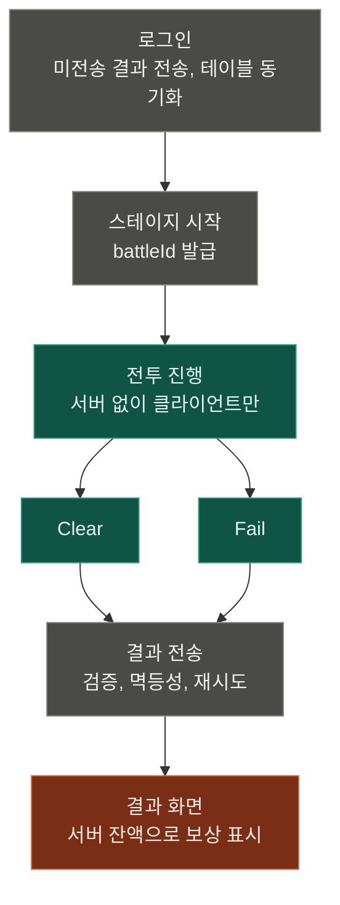
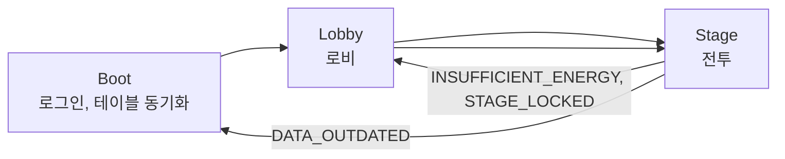
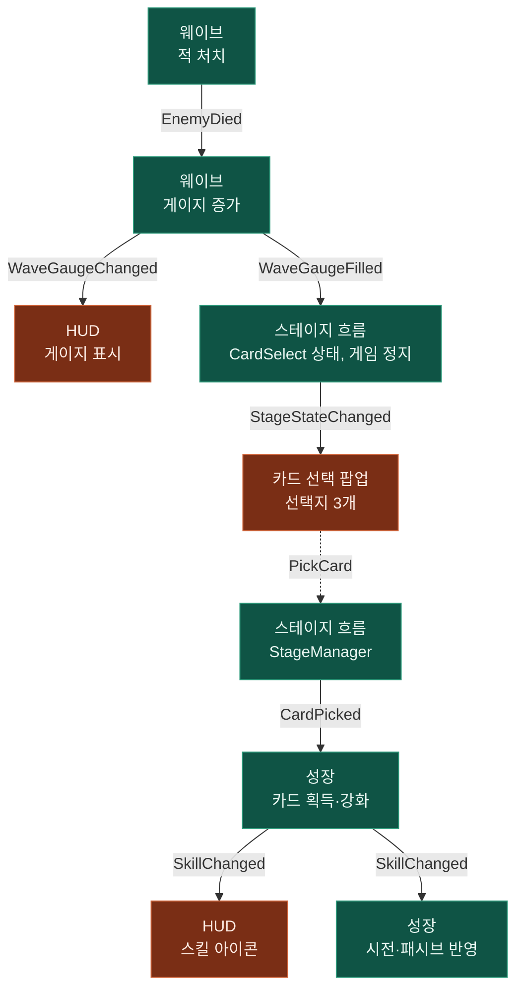
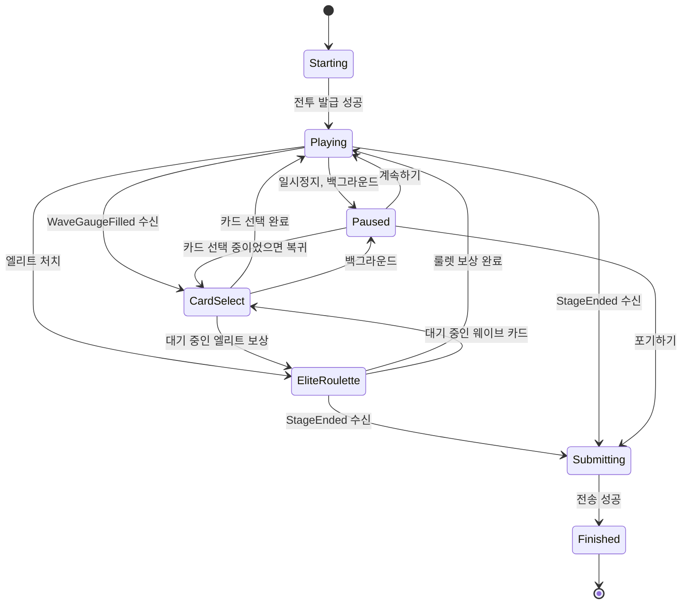

# 주요 흐름

실행 중에 무엇이 어떤 순서로 일어나는지를 다룬다.

> 그림 읽는 법: 초록은 로직, 주황은 뷰, 회색은 서버 통신. 실선은 메시지, 점선은 직접 호출.

## 스토어 업데이트 안내

`LoadingFlow`는 로그인 전에 `IAppUpdateChecker`로 앱 실행당 한 번 새 버전을 확인한다. 업데이트가 있으면 기존 `ConfirmPopupView`에 **업데이트 / 나중에**를 표시한다. 업데이트는 스토어 페이지를 열고, 나중에·닫기는 로그인을 계속한다. 강제 업데이트는 아니며, 조회 실패·5초 제한 시간 초과·미출시 앱은 게임 진입을 막지 않는다. Editor와 데스크톱에서는 조회하지 않는다.

로그인 전에는 신규·저장 계정 모두 만14세 이상 자기확인, 공개 약관 전문과 개인정보 안내 확인, 약관 동의를 진행한다. 연령·약관을 거절하면 인증하지 않고 다시 시도를 기다리며 계정이나 진행을 삭제하지 않는다. 약관 동의와 분석 동의는 별개다. GameAnalytics 수집·이용 및 국외 이전은 각각 선택이며, 하나라도 거절해도 로그인·게임은 가능하다. 둘 다 동의하고 인증·프로필 조회가 성공한 뒤 GA를 초기화한다. Root 진입 시 자동 초기화하지 않는다.

분석 선택은 로그인 흐름마다 확인한다. 새 프로세스에서 동의 전에는 SDK를 초기화하지 않는다. 이미 초기화한 프로세스의 재인증·선택 변경 때에는 이벤트 제출·캐시를 중지하지만 remote config 등 모든 SDK 통신 종료를 뜻하지 않으며, 완전히 종료하고 다시 실행한 경우와 구분한다. Unity Diagnostics와 엔진 데이터는 이 GA 선택으로 제어되지 않는 별도 처리다. 프로젝트/빌드 설정과 처리 근거를 확인해야 한다. 이 앱 버전을 배포할 때에는 공개 개인정보 안내에 실제 로그인 선택·변경 방법과 거절 효과를 맞춰야 한다.

- Android: `StoreUpdate.androidlib`의 공식 Play In-App Update 라이브러리로 설치 계정에 제공되는 업데이트를 조회한다. 문자열 버전이 아니라 Play의 `versionCode` 및 배포 자격을 따른다. 내부 테스트 계정으로 Play에서 설치한 이전 빌드와, 같은 앱 ID·서명에 더 높은 `versionCode`로 배포된 빌드가 있어야 확인할 수 있다. APK를 직접 설치한 것만으로는 이 조건을 보장하지 않는다. [Google 테스트 안내](https://developer.android.com/guide/playcore/in-app-updates/test)를 따른다.
- iOS: Apple Lookup API로 같은 bundle ID의 **App Store 공개 버전**을 `Application.version`과 숫자 단위로 비교한다. 기기의 지역 설정 국가를 조회에 사용하며, 국가를 얻지 못하면 KR을 사용한다. Apple ID 스토어 국가와 기기 지역이 다르면 해당 국가의 배포 상태가 다를 수 있다. TestFlight의 새 테스트 빌드·빌드 번호는 조회하지 않으므로 TestFlight에서 업데이트한다. [TestFlight 안내](https://testflight.apple.com/)를 참고한다.

이 기능이 포함된 빌드를 먼저 설치해야 이후 업데이트를 안내할 수 있다. 안내 버튼은 다운로드 페이지로 이동하며 실제 다운로드·설치는 스토어에서 사용자가 진행한다.

## 스테이지 생명주기와 서버 통신 구간

회색 세 곳만 서버와 통신한다.

### 실패와 복구

| 어디서 | 무슨 일이 | 그다음 |
| --- | --- | --- |
| 스테이지 시작 | `DATA_OUTDATED` | Boot로 이동해 재동기화 후 다시 발급 |
| 스테이지 시작 | `INSUFFICIENT_ENERGY`, `STAGE_LOCKED` | Lobby로 이동 |
| 스테이지 시작 | 그 밖의 실패 | 재시도 또는 Lobby |
| 전투 진행 | 일시정지에서 포기하기 | 판정 없이 결과 전송으로 |
| 결과 전송 | 네트워크·서버 오류 | 자동 재시도 3회 → 수동 재시도 버튼 |
| 결과 전송 | 거절 (만료, 검증 실패 등) | 거절 안내 후 Lobby |
| 결과 전송 중 | 앱 강제 종료 | 다음 로그인 때 "미전송 결과 전송"에서 보냄 |

### 꼭 지킬 것

- Clear·Fail은 상태가 아니라 결과값이다. 실패해도 새 상태를 만들지 않고 같은 상태에 머문 채 실패 메시지만 방송한다
- 미전송 결과는 새 전투 발급보다 **반드시 먼저** 보낸다. 새 발급이 진행 중 전투를 포기 처리하기 때문이다
- 재시도 요청은 처음 만든 스냅샷을 그대로 쓴다. 매번 새로 만들면 `playTime`이 달라져 다른 요청이 된다
- 골드는 `+=`가 아니라 서버 잔액으로 덮어쓴다. 재전송 때 두 번 표시되는 것을 막는다

## 기기 내 전투 이어하기

- `BattleCheckpointDriver`가 프레임 처리가 끝난 전투 상태를 1초마다 수집한다. JSON 변환·파일 쓰기·동기화·교체는 한 백그라운드 작업에서 순서대로 처리하며, 처리 중 새 요청은 최신 대기 한 건만 유지한다. 앱 비활성화·백그라운드 전환·종료 시에는 최신 상태를 접수하고 완료까지 기다린다. 예고 없이 프로세스가 종료되면 마지막 완성본까지 진행이 되돌아갈 수 있다. 보통 약 1초 이내지만 파일 처리가 지연되면 더 늘어날 수 있다.
- 새 실행의 첫 로비에서 진행 중인 전투의 스테이지·웨이브·시간을 보여 주고 이어하기 또는 포기를 고른다. 이어하기는 기존 `battleId`로 Stage를 열며 전투 발급과 에너지 차감을 반복하지 않는다.
- 웨이브·소환 대기열·적 위치/HP/상태이상/패시브·적 투사체·스킬/강화/쿨타임·진행 중인 공격·방벽·통계·난수·카드 선택·룰렛을 함께 복원한다. 정상 Start를 거쳐 프레임 처리가 끝난 뒤 상태를 적용하고 마지막에 Stage 상태를 발행한다.
- 이미 결과 전송 중인 기록은 로비에서 선택을 기다리지 않고 같은 요청으로 재전송한다. 결과 반영·전송 거절·이어하기 포기·새 전투 발급·로그아웃 시 기록을 지운다.
- 스킬 설정은 불변 객체 단위로 저장용 복사본을 공유한다. HP·위치·쿨타임 같은 가변 상태는 매번 독립 복사해 워커와 공유하지 않는다. 직렬화기·UTF-8 출력 버퍼·검증 집합은 단일 워커에서 재사용하며 큰 JSON 문자열과 바이트 배열을 매번 생성하지 않는다.
- 삭제는 대기 요청을 취소하고 진행 중인 파일 교체 뒤에 수행한다. 이전 세대의 작업이 삭제된 파일을 다시 만들 수 없다. 스레드를 지원하지 않는 WebGL은 동기 저장을 사용한다.
- `IBattleCheckpointStore`의 구현은 Network의 `LocalBattleCheckpointStore`다. 서버에는 전투 실행 상태를 보내지 않는다. 계정·앱/테이블 내용·로컬 전투 발급 기록이 맞을 때만 읽으며 임시 파일과 이전 완성본을 사용해 교체한다.
- 에디터/일반 플레이어에서는 계정 세이브 옆의 `.battle` 파일을 쓴다. Android는 OS 백업 제외 폴더, iOS는 전용 폴더에 백업 제외 플래그를 사용해 삭제 후 재설치한 앱에 이어하기 기록이 돌아오지 않게 한다.

## 씬 흐름

씬은 Boot, Lobby, Stage 셋뿐이다. 인터페이스(`ISceneNavigator` 등)는 Core, 전환 구현은 Boot에 있다([architecture.md](architecture.md)).

## 웨이브 게이지와 카드 선택

카드를 고르면 팝업이 `StageManager.PickCard(cardId)`를 호출하고(호출), `CardPicked`는 StageManager가 발행한다. 웨이브당 카드는 정확히 1장이고, 마지막 웨이브는 카드 없이 클리어한다.

- 일시정지 후 CardSelect로 돌아올 때는 선택지를 새로 뽑지 않는다. 일시정지로 리롤하는 꼼수를 막기 위해서다

### 엘리트 룰렛

`EnemyDied.Type`이 Elite이면 `StageManager`가 룰렛 보상을 대기열에 넣는다. `EliteRoulette` 상태에서는 전투 시간이 0이고, 바늘과 카드 등장 연출은 unscaled time으로 진행한다. 이미 카드 선택이나 일시정지 중이면 그 흐름을 마친 뒤 룰렛을 연다.

8칸에는 보유 무기 중 현재 강화 가능한 무기가 무작위로 들어간다. 무기가 적으면 중복 배치하며, 무기를 먼저 같은 확률로 뽑고 그 무기의 강화 후보를 뽑는다. 스테이지의 `EliteRouletteMinCards`~`EliteRouletteMaxCards` 범위에서 횟수를 정하고 한 번씩 회전·적용·카드 표시를 반복한다. 두 값이 0이면 룰렛을 사용하지 않는다.

당첨 강화는 기존 카드 적용 규칙으로 한 번만 적용하고 전투 buildLog에 기록한다. 매 회차 후보를 다시 확인하므로 만렙·선행 조건·카드 상한을 넘지 않는다. 후보가 소진되면 남은 회차를 마치며, 대기 중인 룰렛이나 웨이브 카드가 있으면 계속 정지한 채 먼저 처리한다. 모든 보상이 끝나면 이전 배속으로 재개한다. 전투 종료 시 대기 보상과 연출은 취소하며 뒤늦은 연출 완료가 전투를 재개하지 않는다.

## 스테이지 상태 머신

여기 없는 전환은 무시된다.

